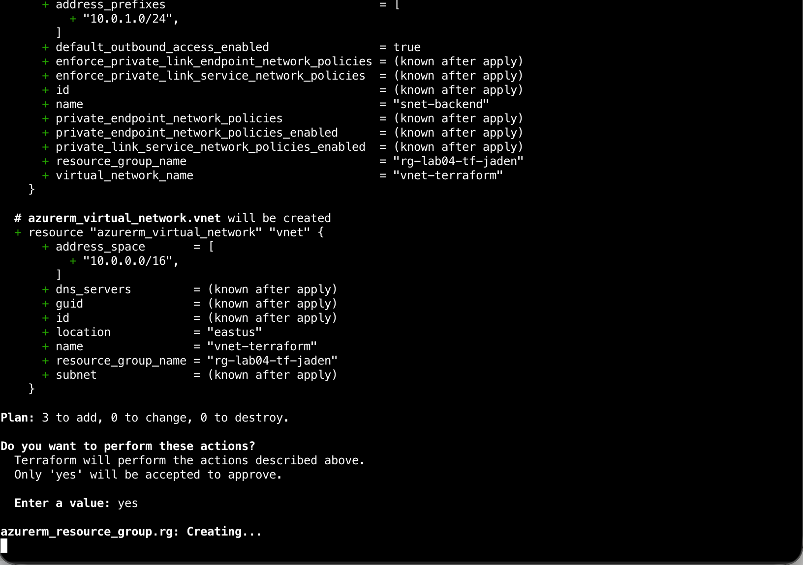
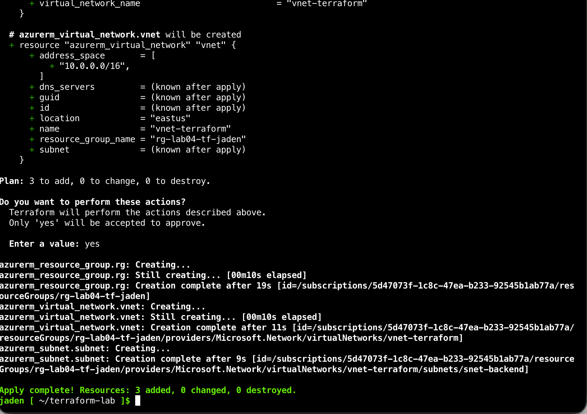
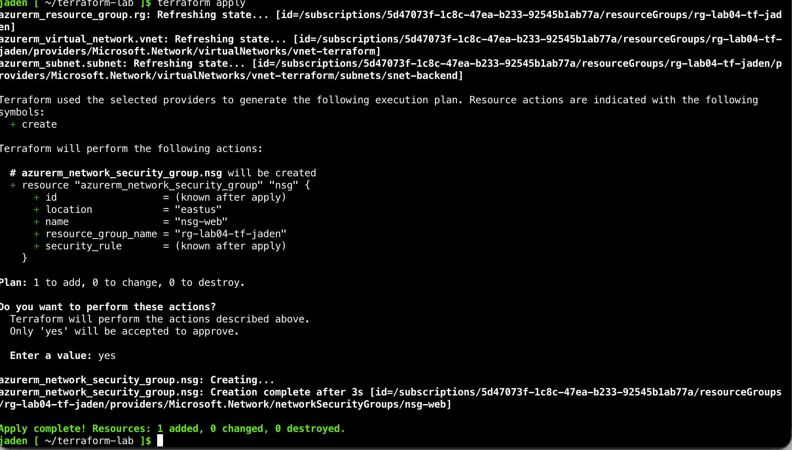
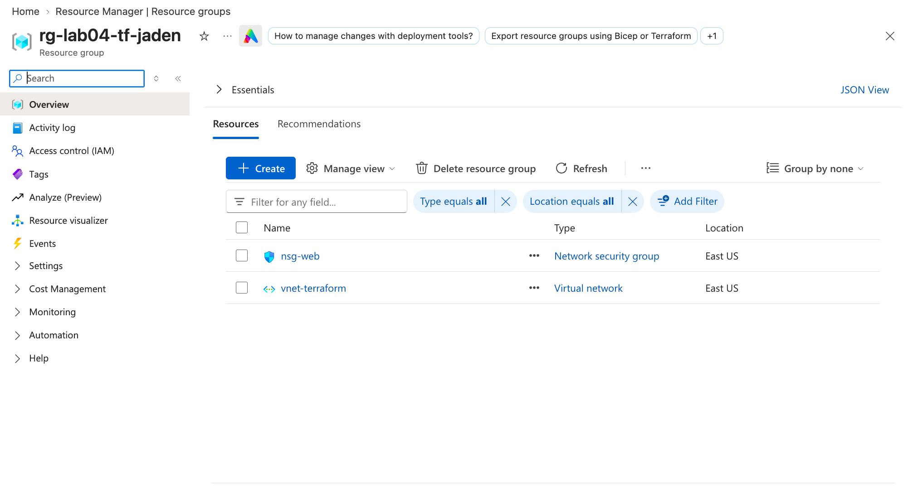
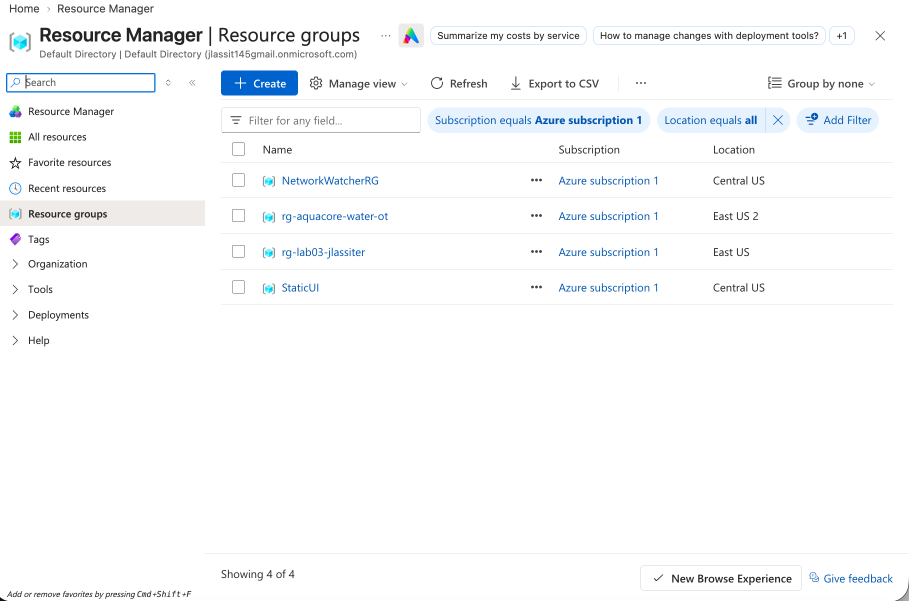

# Terraform Lab 04: Azure Basics (Resource Group, VNet, Subnet, NSG)

Week 4 of my Azure portfolio. My first Infrastructure as Code (IaC) project: I describe Azure resources in Terraform's HCL language and let Terraform build, change and tear them down.

> **Scope note:** built in Azure Cloud Shell with my own troubleshooting notes. This is not a production deployment. The NSG is intentionally empty (no custom rules, not attached to a subnet).

## What this proves

I can write Terraform that creates a small Azure network, read a `plan` before applying it, add a resource afterward and see Terraform change only the difference, and clean everything up with `terraform destroy`.

## What was built

| Resource | Terraform name | Azure name | Notes |
|---|---|---|---|
| Resource group | `azurerm_resource_group.rg` | `rg-lab04-tf-jaden` | East US |
| Virtual network | `azurerm_virtual_network.vnet` | `vnet-terraform` | `10.0.0.0/16` |
| Subnet | `azurerm_subnet.subnet` | `snet-backend` | `10.0.1.0/24` (251 usable IPs; Azure reserves 5) |
| Network security group | `azurerm_network_security_group.nsg` | `nsg-web` | Added in a second apply; empty |

The VNet and subnet reference the resource group in code (`azurerm_resource_group.rg.name`), so Terraform knows to create the resource group first. I did not have to order anything by hand.

## Workflow I ran

1. `terraform init` downloaded the `hashicorp/azurerm` provider (v3.117.1) and wrote `.terraform.lock.hcl` to pin the version.
2. `terraform plan` showed **3 to add**.
3. `terraform apply` created the resource group, VNet and subnet.
4. I added the NSG to `main.tf`. `terraform plan` showed **1 to add** (not 4), because the other three already matched the state.
5. `terraform apply` created the NSG.
6. I verified in the Azure portal.
7. `terraform destroy` removed all **4** resources.

## Evidence

First plan, 3 resources to add:



First apply:



Second plan, only the NSG to add:



Resources in the portal:



Destroy output:

```
azurerm_resource_group.rg: Destruction complete after 15s

Destroy complete! Resources: 4 destroyed.
```

Resource group gone from the portal afterward:



## Knowledge check (in my own words)

**What does `terraform init` download and why?**
The provider plugin (`azurerm`), which is the code that lets Terraform talk to Azure's API. It also writes a lock file that pins the provider version. Terraform cannot do anything until it has the provider.

**`plan` vs `apply`?**
`plan` previews what would be added, changed or destroyed by comparing my code to the state and to Azure, and changes nothing. `apply` makes those changes.

**What is `terraform.tfstate` and why not delete it?**
It is Terraform's record of which real Azure resources it manages. Without it Terraform thinks nothing exists, so it would try to recreate everything (and hit "already exists" errors) and the old resources would be orphaned.

**Why "1 to add" instead of 4 for the NSG?**
Terraform compares my code to the state. The first three resources already existed and matched, so the NSG was the only difference.

**Why `destroy` instead of deleting in the portal?**
`destroy` removes what Terraform tracks in the right dependency order and keeps the state accurate. Deleting in the portal makes the state drift from reality and confuses the next plan.

## Honest notes and things that went wrong

- **Cloud Shell storage was ephemeral.** My session reset mid-lab and `main.tf` and the state were gone. I recreated `main.tf` from my notes before applying. Lesson: download your files early, and run `destroy` in the same session as `apply`, because a lost state file leaves resources Terraform can no longer track.
- **Slow first plan, and I interrupted it.** The first `plan` on a fresh subscription spent time auto-registering Azure resource providers and printed nothing for a while. I pressed Ctrl+C, which caused a "context canceled" error on provider `Microsoft.AVS`. Re-running and letting it finish worked. My final `main.tf` has no registration setting. Terraform's error message also documents `resource_provider_registrations = "none"` for accounts that cannot register providers, which I did not need.
- **Terminal flooded with input.** A key repeated into the terminal at the `yes` prompt and froze the tab. Terraform only accepts the exact word `yes`, so nothing was applied. I restarted Cloud Shell.
- **Empty NSG.** `nsg-web` has no custom rules and is attached to no subnet, so it does not filter any traffic yet. The portal showed "0 subnets, 0 network interfaces" and only Azure's default rules.
- **Local state only.** State lived in a local file. A real team setup would store it in remote storage (for example an Azure Storage account) with locking. I did not build that here.

## Cost control

VNets, subnets and NSGs are free to hold, but I ran `terraform destroy` anyway and confirmed the resource group was gone in the portal.

## What I learned

- Terraform builds a dependency graph from references between resources, so order comes from the code.
- Reading the `plan` before `apply` is the safety step.
- The state file is what ties my code to real resources.

## Files

- `main.tf`: the Terraform configuration
- `.terraform.lock.hcl`: provider version lock (committed on purpose)
- `.gitignore`: keeps state files and local plugins out of Git
- `screenshots/`: evidence
